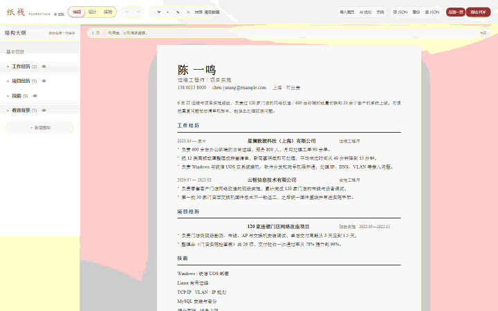
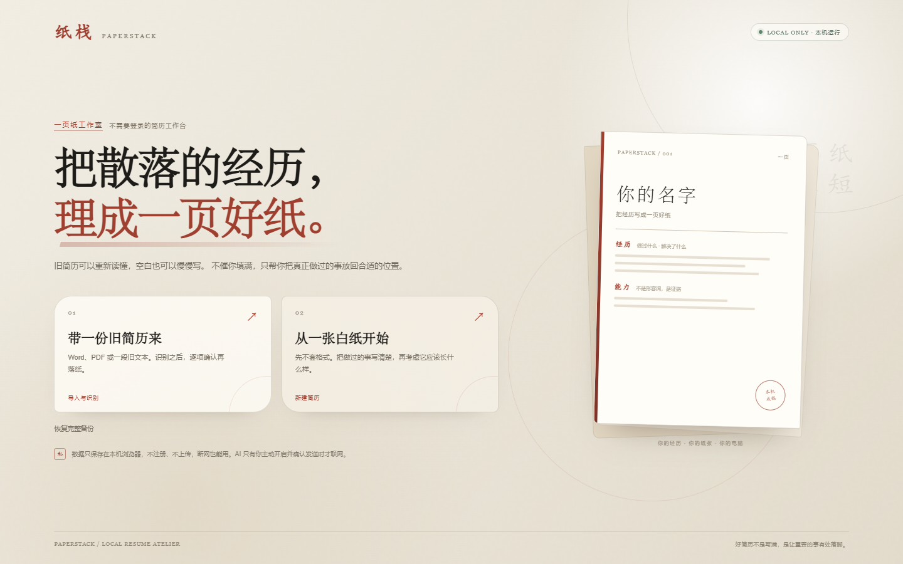
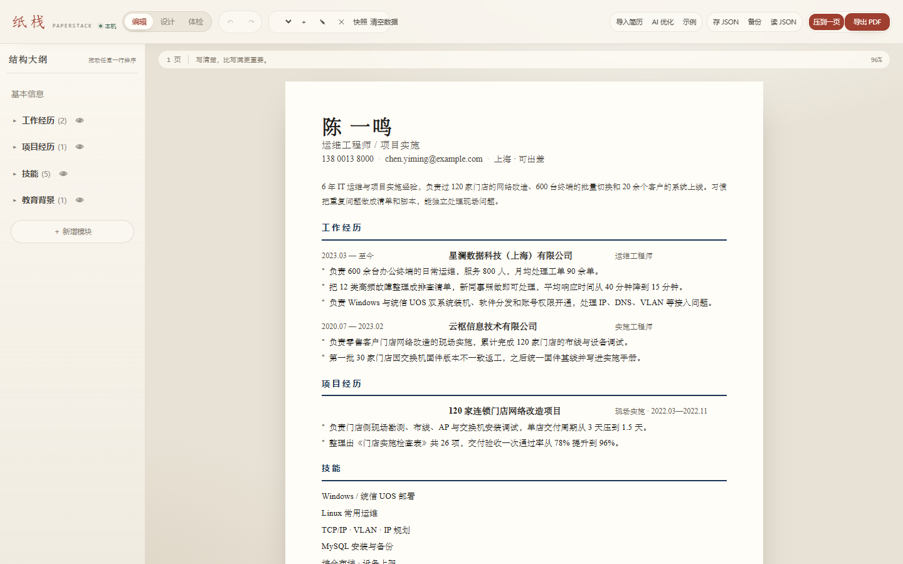
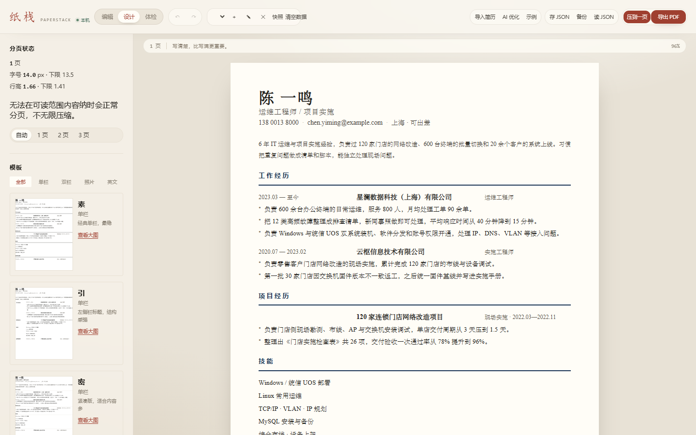
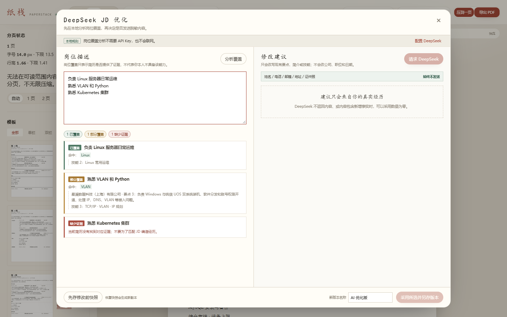
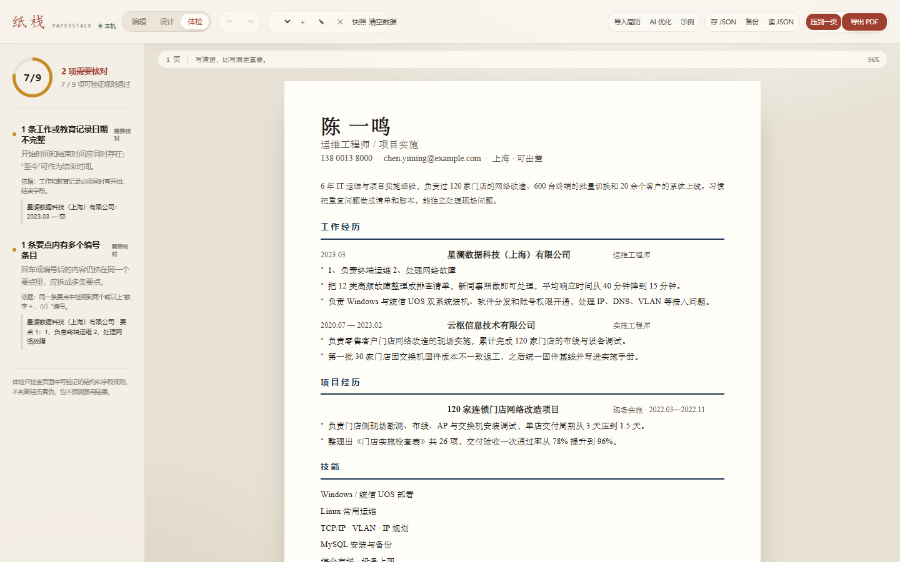
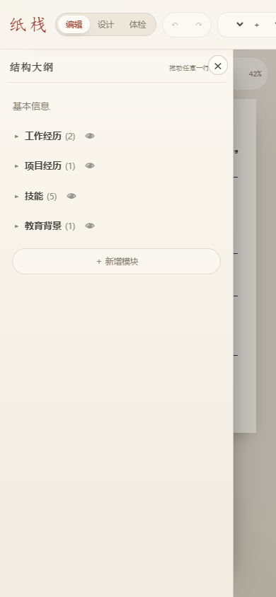

# 纸栈 Paperstack

离线运行、不上传任何数据的中文简历工具：导入旧简历、自动拆分、套模板、智能分页、一键导出 PDF。

> 当前版本 **v0.7.0**。P1–P6 功能和真实 DeepSeek 联调已完成；发布前 QA 发现的编辑状态、保存与备份问题已修复，真实复杂 PDF 仍在最后验收。

## 特点

- **默认零网络请求**：不注册、不上传、无统计或埋点，数据只存在本机 IndexedDB。
- **双击能用**：构建产出单个 HTML，支持 `file://`，断网可用。
- **导入识别**：支持 Word（.docx）、PDF 和粘贴文本，识别后在左右对照页核对，再导入为新版本。
- **两级结构大纲**：模块、条目可拖拽排序；按产品决定不做要点拖拽。
- **预览原地编辑**：点击内容在纸张内展开编辑，编辑期间不重新分页。
- **多版本与撤销重做**：版本内容独立，每个版本有独立撤销栈。
- **命名快照**：保存当前内容和样式，恢复时生成新副本，不覆盖原版本。
- **清空数据**：二次确认后一键清除所有简历和快照，回到首次使用状态。
- **10 套原创模板**：覆盖单栏、双栏、彩色侧栏、证件照与英文标题/日期格式。
- **证件照本地处理**：上传后可拖动裁剪，压缩为宽 300 px JPEG，只保存在本机浏览器。
- **智能分页**：条目拆分、长段落断行、避免孤标题、非末页留白撑开。
- **DeepSeek JD 优化**：本地分析岗位覆盖，默认移除身份信息，发送前展示真实载荷，建议逐条审阅并另存版本。
- **窄屏抽屉**：窄屏下大纲、设计和体检面板收为抽屉，简历预览保持主区域。

## 界面















## 直接用

**双击根目录的 `纸栈.html`**（构建时自动生成）。

⚠️ 不要双击 `index.html`——那是 Vite 的开发入口，`file://` 下会白屏。

## 开发

```bash
pnpm install
pnpm dev        # 开发服务器
pnpm build      # 产出 dist/index.html，并复制为根目录 纸栈.html
pnpm test       # 单元测试：77 条
pnpm typecheck  # TypeScript 静态检查
pnpm test:e2e   # 端到端测试：101 条，自动先构建
```

没有 pnpm 时，可使用 `npm run dev`、`npm run build`、`npm test`、`npm run test:e2e`。

提交和协作约定见 [CONTRIBUTING.md](CONTRIBUTING.md)。

## 发布

推送到 GitHub 的 `main` 分支后，Actions 会运行单元测试并构建单文件产物。首次发布时在仓库 Settings → Pages 中将 Source 设为 **GitHub Actions**。

```bash
pnpm test
pnpm build
pnpm demo:gif
pnpm fixtures:resumes
```

## 目录

```
src/
├─ core/       数据模型、版本、撤销、IndexedDB 存储与旧数据迁移
├─ layout/     排版引擎：测量 → 压缩决策 → 分页 → 撑开
├─ render/     状态 → HTML，JSON Resume 导出
├─ import/     docx / PDF / 文本读取与拆分规则
├─ inline/     预览原地编辑与定位
├─ ai/         DeepSeek 请求、默认脱敏、JD 覆盖与建议校验
├─ templates/  模板注册表
├─ components/ 结构大纲、导入确认、体检
└─ styles/     版式与打印样式
```

## 已实现 / 未实现

| 计划书条目 | 状态 |
|---|---|
| R1 Vite + TS + Vue 3 + 单文件打包 | ✅ |
| R2 自定义模块（条目式 / 要点式 / 段落式） | ✅ |
| R3 模块、条目两级拖拽 | ✅；不做要点拖拽 |
| R4 多版本 | ✅ |
| R5 撤销 / 重做 | ✅ |
| R6 10 套模板 | ✅ 单栏、双栏、照片、彩色侧栏、英文均已实现 |
| R7 全部模板支持分页 | ✅ 双栏主栏独立分页；侧栏溢出会明确提示 |
| R8–R11 导入与 OCR 占位 | ✅ 10 份 PDF + 10 份 DOCX 脱敏夹具验收通过 |
| R16 预览原地编辑 | ✅ 含跨页拆分条目完整编辑 |
| R17 启动双入口 | ✅ 首次 / 新建双入口，已有版本直达 |
| R18 编辑 / 设计 / 体检三模式 | ✅ 三模式切换 + 体检定位 |
| R19 模板画廊 | ✅ 统一样例缩略图、筛选、预览后切换 |
| R20 可解释智能分页 | ✅ 分页报告 + 页数目标 + 下限 |
| R21 命名快照 | ✅ 创建、持久化、比较、恢复为新副本 |
| R22–R24 AI 审阅、JD 覆盖与脱敏 | ✅ DeepSeek、逐条审阅、风险提醒、发送前载荷确认 |
| R14 发布材料 | ✅ README、截图、MIT 协议、Pages 工作流 |
| R15 自动化测试 | ✅ 77 条单元测试 + 101 条端到端测试 |

## 后续顺序

1. 创建 GitHub 远程仓库，推送 `main` 并启用 Pages。
2. 用在线地址做最后一次发布验收。


## 计划文档

- [纸栈项目开发计划书 v1.1](纸栈项目开发计划书-v1.1.md)：**当前执行依据**。
- [纸栈项目开发计划书 v1.0](纸栈项目开发计划书.md)：历史版本。
- [项目进度书](项目进度书.md)：实际完成情况和已知问题。

## 隐私

工具本身不含统计、埋点或网络调用。导入的简历只在本机解析与保存。DeepSeek AI 默认关闭；只有用户主动启用、填写自己的 API Key，并在发送预览中确认后才会联网。姓名、电话、邮箱、城市、地址和证件照始终不发送。

## 协议

本项目使用 [MIT 协议](LICENSE)。GitHub Pages 工作流见 [`.github/workflows/pages.yml`](.github/workflows/pages.yml)。
